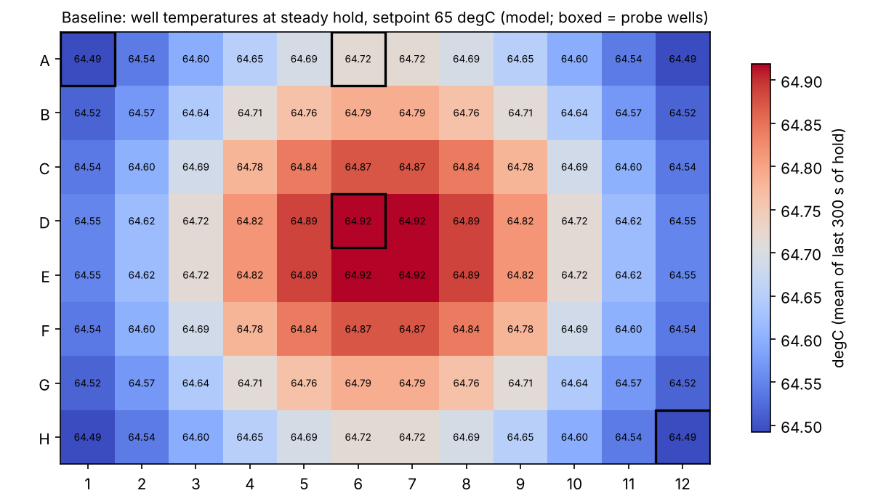

# heatblock-uniformity

Open tools for checking how evenly a laboratory heating block holds its temperature — for example a 65 °C block used for hybridization capture in NGS library preparation.

- **3-D thermal model** of an aluminium block with a PI-controlled heater pad, verified against analytic solutions
- **Analysis pipeline**: relative probe calibration, uniformity metrics, first-order time-constant fits
- **Arduino firmware + Python logger** for up to 8 DS18B20 probes
- **Parametric probe-guide fixture** (CadQuery → STEP / STL)

**Why:** during my internship, the library concentration after hybridization capture varied from run to run. Block temperature is one of the factors behind capture efficiency, and instrument makers advertise uniformity figures, but independent measurements are rarely published — see [docs/field-problems.md](docs/field-problems.md).

**Maintainer:** Suining Liu — laboratory technician intern at Burning Rock (燃石医学), Irvine, California, May–June and July–August 2026.

> **Status (v0.1):** all results so far are model predictions or synthetic data generated by the model. No physical block has been measured yet. See [docs/REPORT.md](docs/REPORT.md).



## Key findings so far (model)

| | Baseline block | Best combined design |
|---|---|---|
| Steady spread across 96 wells | 0.43 °C | 0.04 °C |
| Mean well temperature vs set point | −0.31 °C | −0.02 °C |
| Largest spread during heat-up | 2.96 °C | 0.46 °C |
| Hold power | 9.2 W | 3.1 W |

The predicted spread is smaller than a DS18B20’s stated ±0.5 °C accuracy, so the probes must be calibrated against each other first. On synthetic data, skipping that step overstates the spread by 74 % and picks the wrong warmest well; a 15-minute water-bath calibration recovers the true spread to 0.003 °C.

## Quick start

```bash
pip install -e ".[dev,cad]"
pytest -q                              # verification tests
python scripts/run_variants.py --quick # fast coarse model run (under a minute)
python scripts/run_variants.py         # full run, grid study + figures (~8 min)
```

Analyse a log (synthetic or real):

```bash
python scripts/make_synthetic.py   # needs results/baseline.npz from run_variants.py
python scripts/analyze_run.py --run data/synthetic/baseline_run.csv \
  --cal data/synthetic/calibration_bath.csv --block-probes A1,A6,D6,H12 \
  --setpoint 65 --t-off 1800 --out results/analysis_synthetic
```

Record from hardware: `heatblock-log --port /dev/ttyACM0 --labels A1,A6,D6,H12,ambient --out data/raw/run.csv`

## Repository layout

```
src/heatblock/   model.py  analysis.py  synthetic.py  logger.py  io.py  geometry.py
scripts/         run_variants.py  make_synthetic.py  analyze_run.py  render_cad.py
firmware/        heatblock_logger/heatblock_logger.ino
cad/             probe_fixture.py  out/ (STEP, STL, SVG)
data/synthetic/  generated logs (clearly labelled, not measurements)
docs/            REPORT.md  figures/
tests/           model verification, analysis, I/O, logger
```

## Limitations

The block is modelled as solid (tubes and liquid not resolved), heat-transfer coefficients are assumed, and the firmware has not yet been run on hardware. Details and next steps in the report.

## License

Code, CAD scripts and generated CAD files: MIT (see `LICENSE`). Documentation and figures: CC BY 4.0.
This is an engineering and teaching project. It is not a medical device and is not validated for clinical use.
