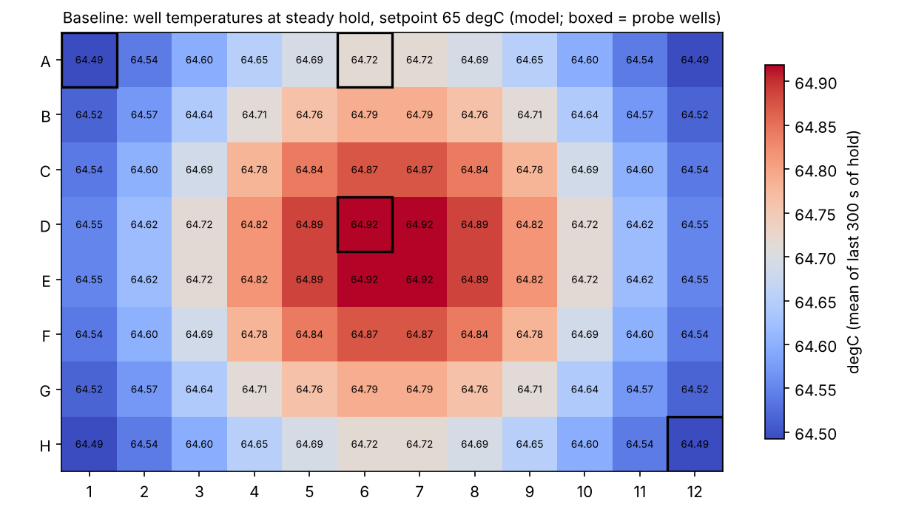
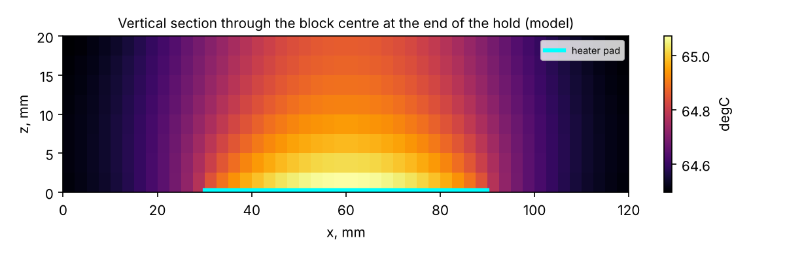
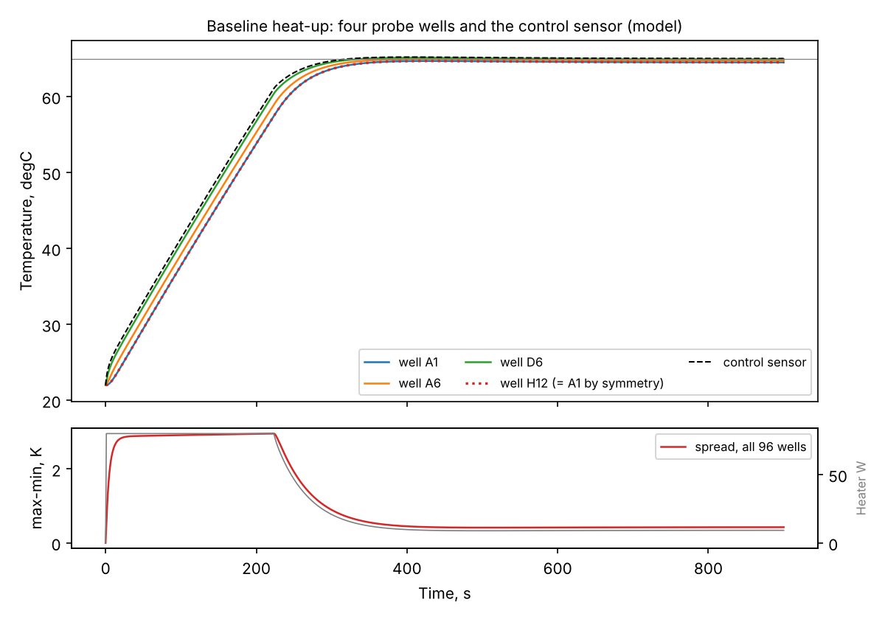
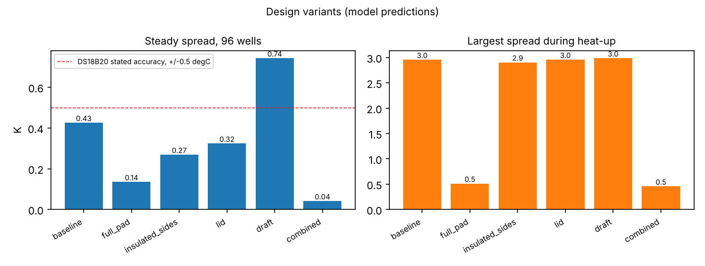
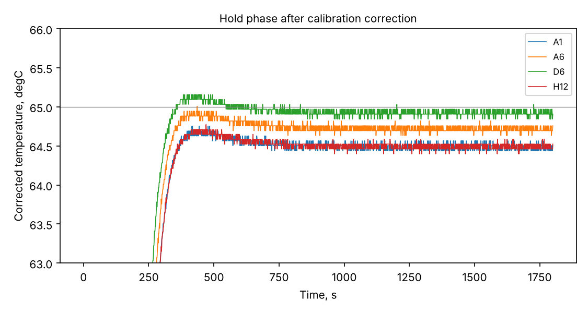
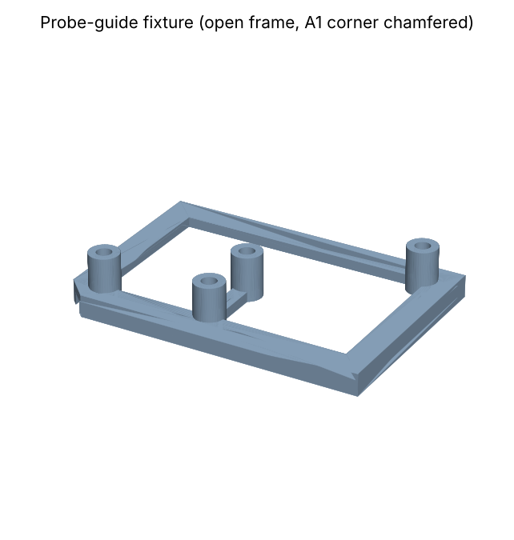

# Temperature uniformity of a 65 °C heating block: model, measurement pipeline and probe fixture

**Project report, version 0.1 — November 2026**

> **Status.** Every number in this report comes from the thermal model or from synthetic data generated by the model. **No physical block has been measured yet.** The pipeline is built so that a real log recorded with the included firmware and logger can be analysed with the same commands (Section 8).

---

## 1. Question

Hybridization capture, the target-enrichment step used by most cancer gene panels, incubates the library with probes at about 65 °C for hours. Reagent suppliers list the temperature of the heating instrument as one of the factors that change capture efficiency, and instrument advertisements state uniformity figures, but I could not find a public, reproducible measurement of how uniform an ordinary heating block actually is. (Background: [field-problems.md](field-problems.md).)

This project asks three questions:

1. How large are the well-to-well temperature differences in a simple aluminium block held at 65 °C, at steady state and during heat-up?
2. Which design changes (heater size, insulation, a lid) reduce them, and what do they cost?
3. Can those differences be measured with low-cost DS18B20 probes, whose stated accuracy is ±0.5 °C?

## 2. What is in the repository

| Part | Path | Purpose |
|---|---|---|
| Thermal model | `src/heatblock/model.py` | 3-D transient heat conduction with a PI-controlled heater |
| Analysis | `src/heatblock/analysis.py` | probe calibration, uniformity metrics, first-order (τ) fits |
| Synthetic data | `src/heatblock/synthetic.py` | what the probes would record, including offsets, lag, noise and quantisation |
| Firmware | `firmware/heatblock_logger/` | Arduino sketch for up to 8 DS18B20 probes on one wire |
| Logger | `src/heatblock/logger.py` | records the serial stream to CSV |
| Probe fixture | `cad/probe_fixture.py` | parametric CadQuery model, exported to STEP and STL |
| Tests | `tests/` | 15 tests, including analytic verification of the model |

## 3. Model

### 3.1 Geometry and materials

| Item | Value |
|---|---|
| Block | 120 × 80 × 20 mm, aluminium 6061-T6 (k = 167 W/m·K, ρ = 2700 kg/m³, c = 896 J/kg·K) |
| Wells | 96, 8 × 12, 9 mm pitch (ANSI/SLAS 4-2004 spacing), centred; temperature read 10 mm below the top face |
| Heater | flat pad on the bottom face, 60 × 40 mm, centred, 80 W maximum |
| Control | PI controller (k_p = 0.25 /K, k_i = 0.0015 /K·s, anti-windup) on one sensor embedded 5 mm above the bottom at the block centre; set point 65 °C |
| Ambient | 22 °C |

### 3.2 Boundary conditions

Losses are modelled with effective heat-transfer coefficients h that include radiation. Values are typical for still air and are assumptions to be checked against measurement (Section 9).

| Surface | h, W/m²·K (baseline) |
|---|---|
| Top | 10 |
| Sides | 10 |
| Bottom outside the pad | 5 |
| Bottom under the pad (insulated backing) | 2 |

### 3.3 Numerical method

The block is divided into cubic cells (2.5 mm, 12 288 cells). Each cell exchanges heat with its six neighbours by conduction and, on the outside, with the air through a conductance that puts convection in series with conduction across half a cell. Time stepping is backward Euler with Δt = 0.5 s. Because the scheme is implicit, it is stable for any time step; the matrix is factorised once (sparse LU) and reused for all 10 800 steps, so a 90-minute run takes about 47 s.

Each run has two phases: controlled heat-up and hold from 0 to 1800 s, then heater off and natural cool-down to 5400 s.

### 3.4 Assumptions

- The block is solid. Well holes, plastic tubes and the liquid in them are not resolved, so “well temperature” means block temperature at the well position. The sample inside a tube will lag behind and sit slightly below this value.
- Constant material properties; contact resistance between heater and block neglected.
- The controller output is treated as continuous power (an averaged PWM signal).

## 4. Verification

Before trusting any result, the code was checked against problems with known answers. These checks run automatically on every commit (`tests/test_model.py`, GitHub Actions).

| Check | Known answer | Result |
|---|---|---|
| 1-D slab: uniform bottom flux, insulated sides, convective top | linear profile T(z) = T_amb + q/h + q(H − z)/k | matches to 10⁻⁸ °C |
| Lumped heating: uniform h, whole-bottom heater, constant power | T = T_amb + (P/UA)(1 − e^(−t/τ)), τ = C/UA | within 0.5 % of the temperature rise |
| Energy conservation per step | heat stored = heat in − heat lost | equal to 10⁻⁹ relative |
| Symmetry | wells A1, A12, H1, H12 identical | identical to 10⁻⁶ °C |

**Grid convergence** (baseline, hold at 1200 s):

| Cell size | Cells | Steady spread, °C | Largest spread during heat-up, °C |
|---|---|---|---|
| 5.0 mm | 1 536 | 0.4290 | 2.988 |
| 2.5 mm | 12 288 | 0.4253 | 2.956 |
| 1.67 mm | 41 472 | 0.4247 | 2.950 |

Halving the cell size again changes the results by about 0.1–0.2 %, so 2.5 mm is used for all results.

## 5. Results (model)

### 5.1 Baseline block



- **Steady spread across the 96 wells: 0.43 °C.** The warmest wells (D6, D7, E6, E7) sit over the heater; the four corner wells are the coldest.
- **The wells sit on average 0.31 °C below the set point.** The controller holds its own sensor, near the heater, at exactly 65 °C; heat then flows up and out through the block, so every well is a little cooler. A block that “reads 65 °C” is not 65 °C everywhere.





- **During heat-up the spread reaches 2.96 °C**, about seven times the steady value. It follows the heater power (lower panel): while the heater runs at full power, heat enters through the centre faster than it spreads to the edges. All wells are within ±1 °C of the set point after 316 s, and the spread stays below 0.5 °C after 369 s.

### 5.2 Design variants

| Variant | Steady spread °C | Mean well − set point °C | Max spread in heat-up °C | All wells ±1 °C after s | Spread ≤ 0.5 °C after s | Hold power W | Cool-down τ s |
|---|---|---|---|---|---|---|---|
| Baseline | 0.43 | −0.31 | 2.96 | 316 | 369 | 9.2 | 2144 |
| Full-size pad (110 × 70 mm) | 0.14 | −0.08 | 0.51 | 280 | 240 | 8.6 | 2314 |
| Insulated sides | 0.27 | −0.21 | 2.91 | 302 | 326 | 6.6 | 2993 |
| Insulated lid | 0.32 | −0.23 | 2.96 | 303 | 336 | 6.4 | 3107 |
| Air draft (fan or hood nearby) | 0.74 | −0.56 | 2.99 | 387 | never | 16.9 | 1160 |
| Combined (full pad + sides + lid) | 0.04 | −0.02 | 0.46 | 266 | always | 3.1 | 6443 |



What the table says:

1. **Heater size matters most during heat-up.** Spreading the same power over a larger pad cuts the transient spread from 2.96 to 0.51 °C. Insulation and a lid hardly change it, because during heat-up the gradient is set by how heat enters, not by how it leaves.
2. **Insulation and a lid help at steady state but slow cooling.** They cut the hold power by about 30 % and the steady spread by 24–37 %, but the cool-down time constant rises from 36 to 50–52 minutes. For a hold-only step such as overnight hybridization this does not matter; for a cycling instrument it would.
3. **The room can matter as much as the design.** A draft from a fan or a fume hood raises the steady spread by 74 % and pulls the mean 0.56 °C below the set point.
4. **The combined design** reaches 0.04 °C steady spread with one third of the power.

### 5.3 What the first-order (lumped) model can and cannot tell you

The Biot number of the block is about 3 × 10⁻⁴, far below 0.1, so the lumped model (one temperature for the whole block, the first-order ODE C dT/dt = −UA(T − T_amb)) should describe its overall behaviour. It does: the cool-down time constants fitted to individual wells (2143–2145 s for the baseline) agree with τ = C/UA = 2142 s to within 0.2 %, and the same holds for every variant.

But the lumped model has, by construction, a single temperature, so it says nothing about the 0.43 °C spread or the 3 °C transient. **A small Biot number tells you the block heats and cools as one body; it does not tell you the wells are equal.** Uniformity needs the distributed model.

## 6. Can cheap probes measure this?

The predicted steady spread (0.43 °C) is smaller than the stated accuracy of a DS18B20 probe (±0.5 °C). Measured as delivered, probe offsets could hide the real pattern or invent a false one. The fix is a **relative calibration**: put all probes together in one stirred, insulated water bath; the true temperature is the same for all of them, so each probe’s difference from the probe mean is its offset.

To test the whole pipeline before buying hardware, the model output was turned into synthetic logs (`data/synthetic/`), with known offsets (+0.31, +0.12, −0.22, −0.40, +0.19 °C), a 10 s probe lag, 0.03 °C noise and 0.0625 °C quantisation, and analysed with the same script a real log would use.

| Quantity | Truth (model) | Without calibration | With calibration |
|---|---|---|---|
| Probe offsets, °C (A1, A6, D6, H12, ambient) | +0.31, +0.12, −0.22, −0.40, +0.19 | — | +0.310, +0.118, −0.220, −0.398, +0.190 |
| Steady spread, 4 probes, °C | 0.426 | 0.741 (+74 %) | 0.429 |
| Warmest probe | D6 | A6 (wrong) | D6 |
| Cool-down τ, s | 2143–2145 | — | 2143–2147 |



Without calibration the analysis overstates the spread by 74 % and names the wrong warmest well. With a 15-minute bath calibration it recovers the offsets to 0.002 °C and the spread to 0.003 °C.

**Probe placement.** The model also chose where the four probes go. The coldest wells are the corners and the warmest the centre, so probes at A1, A6, D6 and H12 capture the full 96-well spread (0.426 °C either way). A1 and H12 should read the same if the heater is centred; on a real block, a difference between them would reveal an off-centre heater or poor contact.

Two limits remain. A relative calibration removes differences between probes but not their common error, so the absolute bias (−0.31 °C) needs a calibrated reference thermometer in the bath. And the probes’ thermal lag stretches the measured heat-up times slightly (369 s in the model, 388 s from the synthetic probes).

## 7. Probe-guide fixture



A parametric CadQuery model (`cad/probe_fixture.py`, exported to `cad/out/`) holds the probes vertically over the chosen wells, so repeated runs put them in the same place.

- **Open frame, not a plate.** A solid plate would act like the lid variant and lower the top heat loss, changing the spread it is meant to measure (Section 5.2 shows a lid alone changes the spread by about 25 %).
- **A lip around the edge** registers the fixture on the block with 0.25 mm clearance per side.
- **A chamfered A1 corner** stops the fixture being fitted rotated by 180°, which would swap the probe labels.
- All dimensions are parameters (probe diameter, clearance, wells to probe). The default suits 6 mm stainless probes; a block with 0.2 mL PCR wells needs smaller sensors, such as bare TO-92 DS18B20s or 3 mm thermistors.

## 8. Using it with real hardware

1. Build the logger: Arduino UNO, up to 8 DS18B20 probes on pin 2, one 4.7 kΩ pull-up (`firmware/heatblock_logger/`). The sketch has not yet been compiled or run on hardware.
2. Identify probes: warm one at a time by hand and note which column rises.
3. Calibrate: all probes in one stirred, insulated water bath near 65 °C for 15 minutes.
   `heatblock-log --port /dev/ttyACM0 --labels A1,A6,D6,H12,ambient --duration 900 --out data/raw/cal.csv`
4. Run: probes in the fixture, heat to 65 °C, hold 30 minutes, switch off, log the cool-down.
5. Analyse:
   `python scripts/analyze_run.py --run data/raw/run.csv --cal data/raw/cal.csv --block-probes A1,A6,D6,H12 --setpoint 65 --t-off 1800 --out results/run1`

## 9. Limitations and next steps

- **Not yet validated against a real block.** The first measurement should fit the effective h from the cool-down time constant (τ = C/UA) and replace the assumed values, then compare the measured spread with the model.
- Tubes and liquid are not modelled; the sample lags the block. A next model version should resolve one well with tube wall and liquid.
- The heater pad is assumed to be in perfect contact with the block; a gap or uneven adhesive would shift the warm spot.
- Instrument claims seen online (for example ±0.5 °C fluctuation and ±0.03 °C uniformity for a hybridization oven) cannot be checked without access to the instrument; this pipeline is the tool to check them.

## 10. Reproduce

```bash
pip install -e ".[dev,cad]"
pytest -q                                   # 15 tests
python scripts/run_variants.py              # model runs, grid study + figures (~8 min)
python scripts/make_synthetic.py            # synthetic probe logs
python scripts/analyze_run.py --run data/synthetic/baseline_run.csv \
  --cal data/synthetic/calibration_bath.csv --block-probes A1,A6,D6,H12 \
  --setpoint 65 --t-off 1800 --out results/analysis_synthetic
python cad/probe_fixture.py                 # STEP / STL / SVG
```

## References

- J. H. Lienhard IV and J. H. Lienhard V, *A Heat Transfer Textbook*, 6th ed., version 6.00, 2024 (§2.3 thermal resistance; §5.2 lumped-capacity solutions). Free at https://ahtt.mit.edu
- ANSI/SLAS 4-2004, *Microplates — Well Positions*, and ANSI/SLAS 1-2004, *Footprint Dimensions*. https://slas.org/education/ansi-slas-microplate-standards/
- Maxim Integrated (Analog Devices), *DS18B20 Programmable Resolution 1-Wire Digital Thermometer*, datasheet (±0.5 °C from −10 °C to +85 °C; 750 ms 12-bit conversion).
- Adafruit product 381, waterproof DS18B20 probe (6 mm × 30 mm stainless tube). https://www.adafruit.com/product/381
- Random Nerd Tutorials, *Guide for DS18B20 Temperature Sensor with Arduino* (multiple sensors on one bus). https://randomnerdtutorials.com/guide-for-ds18b20-temperature-sensor-with-arduino/
